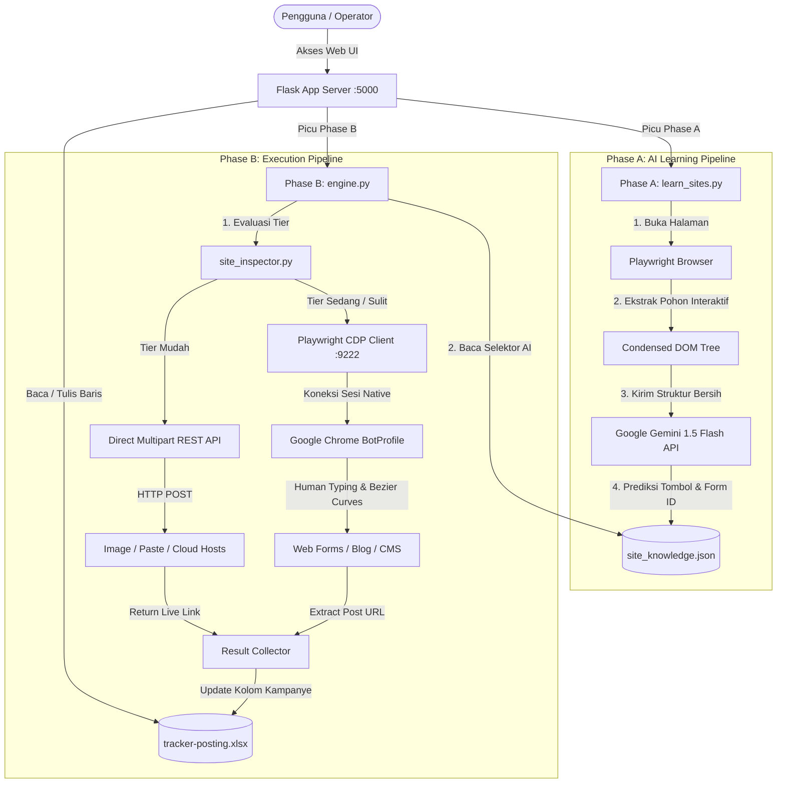

# 📚 Dokumentasi Teknis Sistem (Technical Architecture & Codebase Breakdown)

Dokumen ini membedah arsitektur internal, alur data, logika algoritma, modul kode, dan spesifikasi format data dalam sistem **AutoPost Matrix (DSE Automation)**.

---

## 1. Arsitektur Sistem Tingkat Tinggi

Sistem ini memadukan antarmuka web berbasis Flask dengan dua jalur eksekusi: **Direct REST API** untuk situs mudah dan **Browser Headed/Headless CDP (Playwright)** untuk situs kompleks.



---

## 2. Strategi Klasifikasi & Tiering Situs

Setiap situs dalam `tracker-posting.xlsx` dipetakan ke dalam tingkat kesulitan tertentu oleh [site_inspector.py](file:///d:/Kerja%20praktek/dse%20automation/site_inspector.py) dan [tracker_manager.py](file:///d:/Kerja%20praktek/dse%20automation/tracker_manager.py):

| Tier | Kode | Kriteria | Metode Otomasi | Contoh Platform |
| :--- | :--- | :--- | :--- | :--- |
| 🟢 **MUDAH** | `EASY` | Memiliki endpoint upload publik atau direct multipart API tanpa proteksi Captcha rumit. | Python `requests` (Multipart form POST). Sangat cepat (< 3 detik). | Catbox.moe, Uguu.se, Pixeldrain, FreeImage.host, Telegraph, JustPaste.it |
| 🟡 **SEDANG** | `MEDIUM` | Memiliki formulir HTML standar tetapi membutuhkan rendering JavaScript, penanganan file picker, atau manipulasi DOM. | Playwright Browser via CDP + Universal Form Filler Heuristics. | Form kontak, guestbook, platform blogging sederhana, forum posting |
| 🔴 **SULIT** | `HARD` | Single-Page Application (SPA) berbasis React/Vue/Angular, enkripsi CSRF token, login wajib, atau bot detection. | Playwright Browser via CDP + Profil Chrome Robot Persisten (`BotProfile`) + Kurva Mouse Bezier. | WordPress, Medium, Blogger, Wix, Weebly, Hubspot |
| 🛑 **BLACKLIST** | `SKIP` | Jejaring sosial murni (Instagram, Pinterest, Facebook, X) atau website statis profil perusahaan yang tidak memiliki fitur submit konten. | Dilewati secara otomatis agar tidak membuang waktu eksekusi. | Terdaftar di [blacklist.txt](file:///d:/Kerja%20praktek/dse%20automation/blacklist.txt) |

---

## 3. Fase Pembelajaran AI (Phase A: AI Learning Lab)

Modul: [automation/learn_sites.py](file:///d:/Kerja%20praktek/dse%20automation/automation/learn_sites.py) & [automation/gemini_vision.py](file:///d:/Kerja%20praktek/dse%20automation/automation/gemini_vision.py)

Tujuan Phase A adalah mengidentifikasi elemen interaktif pembuka form posting (seperti tombol *"Create"*, *"Upload"*, *"New Post"*, atau area *Drag-and-Drop*) tanpa perlu menulis selektor CSS secara manual untuk setiap website.

### 3.1. Algoritma Pemadatan DOM (Condensed Interactive Tree)
HTML website modern bisa berukuran beberapa megabyte dan dipenuhi elemen yang tidak relevan (seperti tag iklan, tracking script, SVG kompleks). Mengirim seluruh DOM ke AI akan menghabiskan kuota token dan membingungkan model.

Oleh karena itu, modul mengekstrak hanya **pohon interaktif ringkas**:
1. Mengumpulkan semua elemen klik dan input: `button`, `a`, `input`, `textarea`, `[role="button"]`, `[contenteditable]`.
2. Menyaring elemen yang tidak terlihat (`display: none`, `visibility: hidden`, atau ukuran `width/height == 0`).
3. Memberikan atribut penanda khusus pada elemen: `data-robot-id="1"`, `data-robot-id="2"`, dst.
4. Menghasilkan struktur JSON minimal:
   ```json
   [
     {"id": "elem_1", "tag": "button", "text": "Post Story", "classes": "btn-primary", "href": null},
     {"id": "elem_2", "tag": "a", "text": "Login", "classes": "nav-link", "href": "/login"},
     {"id": "elem_3", "tag": "input", "type": "file", "classes": "dropzone-input"}
   ]
   ```

### 3.2. Prompt Engineering untuk Gemini
JSON di atas kemudian dikirimkan ke model **Gemini 1.5 Flash** dengan prompt terstruktur:
```text
Analyze these interactive UI elements from the target web page:
<condensed_elements_json>

Goal: Find the SINGLE most relevant button/link to START creating a new post or uploading a file.
Priority patterns: ["Create", "New Post", "Upload", "Add", "+", "Postingan Baru", file input dropzones].

Return STRICT JSON only:
{
  "found": true,
  "action_type": "click_button",
  "target_identifier": "the exact ID to target",
  "confidence": 0.0 to 1.0
}
```

### 3.3. Penanganan Rate-Limit & HTTP 429 (Token Bucket & Backoff)
Untuk menghindari pemblokiran batas kuota gratis Gemini (15 RPM), modul mengimplementasikan:
- **Delay Minimal:** Penundaan statis `time.sleep(4.5)` antar permintaan untuk menjaga *throughput* maksimum di ~13 RPM.
- **Exponential Backoff dengan Jitter:** Jika error `429 Too Many Requests` terdeteksi, modul menunggu dengan rumus waktu bertingkat:
  $$\text{Wait Time} = (2^{\text{attempt}} \times 2) + \text{random}(0.5, 2.0)$$

Hasil pembelajaran yang sukses disimpan ke [site_knowledge.json](file:///d:/Kerja%20praktek/dse%20automation/site_knowledge.json).

---

## 4. Fase Eksekusi Publikasi (Phase B: Dual-Engine Batch Runner)

Modul: [automation/engine.py](file:///d:/Kerja%20praktek/dse%20automation/automation/engine.py) & [automation/browser_human.py](file:///d:/Kerja%20praktek/dse%20automation/automation/browser_human.py)

### 4.1. Eksekusi Tier Mudah (Direct API Upload)
Untuk situs seperti ImgBB, Catbox, Pixeldrain, dan Telegraph, modul langsung mengirimkan payload HTTP tanpa membuka browser:
- **Image Hosts:** Membuka file gambar lokal, menyusun payload multipart/form-data sesuai spesifikasi API masing-masing penyedia, lalu mengekstrak tautan gambar dari respon JSON atau teks. Jika user tidak menyediakan gambar, sistem secara otomatis menghasilkan gambar banner teks dinamis (`create_text_banner_image`).
- **Paste Hosts:** Mengirimkan judul dan isi artikel ke endpoint publik (misal Telegraph API `createPage`), lalu mengembalikan tautan publikasi instan.

### 4.2. Eksekusi Tier Sedang & Sulit (Playwright CDP Mode)
Untuk platform yang membutuhkan interaksi browser:
1. **Koneksi CDP (Chrome DevTools Protocol):**
   - Playwright mencoba menyambung ke browser Chrome yang sudah terbuka di port `9222` via `p.chromium.connect_over_cdp("http://localhost:9222")`.
   - Mengapa CDP? Karena CDP menggunakan browser asli pengguna dengan profil persisten di folder [BotProfile/](file:///d:/Kerja%20praktek/dse%20automation/BotProfile), sehingga:
     - Anti-bot (Cloudflare, PerimeterX) tidak mendeteksi flag otomatisasi `navigator.webdriver = true`.
     - Cookie login dan sesi yang sudah pernah dilakukan pengguna tetap tersimpan utuh.
2. **Auto-Routing URL Halaman:**
   - Situs tertentu memiliki URL beranda yang berbeda dengan editor. Modul menyertakan `auto_router` untuk mengarahkan otomatis:
     - `medium.com` $\rightarrow$ `https://medium.com/new-story`
     - `tumblr.com` $\rightarrow$ `https://www.tumblr.com/new`
     - `wordpress.com` $\rightarrow$ `https://wordpress.com/post`
     - `blogger.com` $\rightarrow$ `https://www.blogger.com/post-create.g`
3. **Simulasi Perilaku Manusia (Human Behavior Heuristics):**
   - [automation/human_behavior.py](file:///d:/Kerja%20praktek/dse%20automation/automation/human_behavior.py) menghitung kurva Bezier kubik untuk gerakan mouse dari posisi awal ke koordinat elemen target.
   - Pengetikan teks menggunakan variasi jeda acak (40ms – 120ms per karakter) untuk meniru kecepatan mengetik jari manusia normal.
4. **Ekstraksi Tautan Hasil (Link Interception):**
   - Setelah tombol submit diklik, robot memantau:
     - Perubahan URL browser (`page.url`).
     - Munculnya link baru yang memiliki teks seperti *"View Post"*, *"Copy Link"*, atau *"Share"*.
     - Respon jaringan JSON yang mengandung atribut `url` atau `permalink`.
   - Link yang diperoleh dicatat ke dalam memori job dan disimpan ke Excel.

---

## 5. Bedah Modul Kode Sumber

### 5.1. `app.py`
Server utama berbasis Flask. Menyediakan routing untuk antarmuka web dan API JSON:
- `GET /`: Merender dashboard utama `templates/index.html`.
- `GET /api/tracker`: Mengambil struktur baris situs dan kolom kampanye dari file Excel.
- `POST /api/tracker/campaign`: Menambahkan kolom kampanye baru ke file Excel.
- `POST /api/tracker/update`: Memperbarui sel link tertentu di file Excel.
- `POST /api/upload/start`: Memulai job batch Phase B di thread latar belakang.
- `GET /api/upload/status/<job_id>`: Mengambil log eksekusi langsung (*live streaming*) dan persentase progres.
- `POST /api/learn/start`: Memulai pemindaian Phase A (AI Learner).
- `GET /api/learn/status/<job_id>`: Mengambil progres pembelajaran Phase A.
- `POST /api/verify/start`: Memulai verifikasi tautan kampanye.
- `POST /api/audit/run`: Memulai mass audit kapabilitas situs.

### 5.2. `tracker_manager.py`
Pengelola akses file Excel `tracker-posting.xlsx` menggunakan pustaka `openpyxl`:
- Membaca baris target, kolom default (No, Situs / Web, Kategori, Status), dan seluruh kolom kampanye dinamis.
- Mengimplementasikan penguncian file (*file locking safe guard*) dan mekanisme pembuatan backup otomatis (`.backup.xlsx`) sebelum menyimpan modifikasi untuk mencegah korupsi data.
- Fungsi `categorize_site(domain)`: Mengelompokkan domain ke kategori *Image Host*, *Text / Paste Host*, *Cloud Storage*, *Blog / CMS*, atau *Social / Web Platform*.

### 5.3. `site_inspector.py`
Pemeriksa kelayakan situs:
- `inspect_single_site_fast(situs)`: Mengidentifikasi tier (Mudah/Sedang/Sulit) dan metode upload tanpa request jaringan (berdasarkan database domain).
- `inspect_single_site(situs)`: Melakukan request `HEAD` / `GET` cepat (timeout 3 detik) untuk memverifikasi apakah domain masih aktif atau down (HTTP 200 vs 404/500).
- `SiteInspector.run_full_audit()`: Menjalankan multi-threaded inspection (hingga 30 worker paralel).

### 5.4. `link_verifier.py`
Pemeriksa keabsahan tautan hasil posting:
- Menerima nama kampanye, mengambil seluruh link yang tercatat pada kampanye tersebut, lalu menjalankan pengecekan status HTTP paralel (20 worker).
- Membedakan antara link aktif (200 OK), halaman dihapus/hilang (404 Not Found), atau proteksi akses (403 Forbidden).

### 5.5. `automation/engine.py`
Pengendali eksekusi Phase B. Mengurutkan situs prioritas:
$$\text{Urutan Eksekusi} = \text{Mudah (Direct API)} \rightarrow \text{Sedang} \rightarrow \text{Sulit}$$
Pendekatan ini memastikan persentase sukses awal didapatkan dengan cepat sebelum browser Playwright mengambil alih untuk situs-situs kompleks.

---

## 6. Spesifikasi File Data & Konfigurasi

### 6.1. `tracker-posting.xlsx`
Format tabel Excel:
- **Baris 1:** Header kolom (`No`, `Situs / Web`, `Kategori`, `Status`, `[Nama Kampanye 1]`, `[Nama Kampanye 2]`, ...)
- **Baris 2 s/d N:** Data target website. Nilai pada kolom kampanye berisi URL hasil postingan.

### 6.2. `site_knowledge.json`
Struktur penyimpanan pengetahuan selektor hasil Phase A:
```json
{
  "imgbb.com": {
    "action_type": "click_button",
    "target_identifier": "anywhere-upload-input",
    "learned_at": 1726000000,
    "confidence": 0.95
  },
  "justpaste.it": {
    "action_type": "fill_editor",
    "title_selector": "input#title",
    "body_selector": "div#editor",
    "submit_selector": "button#btn-publish"
  }
}
```

### 6.3. `blacklist.txt`
Daftar domain (satu domain per baris) yang sengaja diabaikan:
- Platform media sosial (misal: `pinterest.com`, `instagram.com`, `facebook.com`, `twitter.com`, `tiktok.com`).
- Platform direktori statis atau forum yang membutuhkan registrasi nomor telepon / KYC.
- Situs yang sudah mati permanen.
