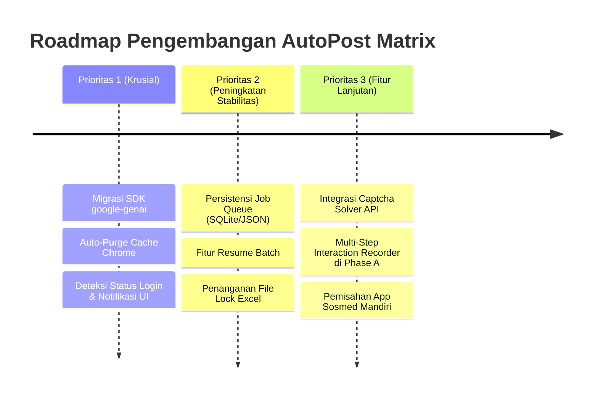

# ⚠️ Evaluasi Sistem, Masalah Teridentifikasi & Roadmap Peningkatan

Dokumen ini memuat analisis jujur dan objektif mengenai **kondisi sistem saat ini**, mencakup kelemahan teknis, bug potensial, batasan arsitektur (*"apa yang belum bener"*), serta rencana solusi perbaikan konkret di masa mendatang (*"apa yang bisa di-improve"*).

---

## 1. Ringkasan Status Sistem Saat Ini

Sistem saat ini sudah bekerja dengan baik untuk:
- ✅ Otomasi upload cepat untuk **Tier Mudah (Direct API)** ke berbagai image & paste host.
- ✅ Eksekusi browser Playwright menggunakan profil persisten Chrome (**CDP Mode Port 9222**) untuk melewati anti-bot standar.
- ✅ Pencatatan dinamis kolom kampanye baru ke dalam file Excel `tracker-posting.xlsx`.
- ✅ Pemangkasan pohon interaktif DOM (Phase A) untuk efisiensi token Gemini AI.
- ✅ Pemisahan filter platform media sosial dan non-upload melalui `blacklist.txt`.

Namun, masih terdapat sejumlah kendala nyata di lapangan ketika menghadapi variasi website dunia nyata yang sangat dinamis.

---

## 2. Apa yang Belum Sempurna / Masalah Saat Ini (Known Issues & Bottlenecks)

### 🔴 Masalah 1: Kuota Ketat Gemini Free Tier & Ancaman Error 429 (Too Many Requests)
- **Gejala / Masalah:**
  Pada Gemini 1.5 Flash Free Tier, terdapat batas kuota **15 RPM (Request Per Minute)** dan batasan harian (1.500 RPD). Jika pengguna memindai puluhan website secara bersamaan di Phase A, API bisa terkena *burst limit* dan mengembalikan error HTTP 429.
- **Kondisi Kode Saat Ini:**
  Sudah diterapkan jeda statis `time.sleep(4.5)` dan retry bertingkat. Namun, jika koneksi internet lambat atau permintaan bertumpuk di thread, jeda ini bisa menyebabkan antrean Phase A terasa sangat lambat (membutuhkan waktu berjam-jam untuk 100 situs).
- **Dampak:** Proses pembelajaran website baru di Phase A harus dilakukan secara bertahap dan tidak bisa dipacu terlalu cepat.

---

### 🔴 Masalah 2: Situs dengan Captcha Interaktif (Cloudflare Turnstile, hCaptcha, Google reCAPTCHA v3)
- **Gejala / Masalah:**
  Meskipun Chrome Robot CDP mode berhasil melewati deteksi bot dasar (`navigator.webdriver = false`), beberapa website menerapkan tantangan interaktif Cloudflare (misal kotak centang *"Verify you are human"* atau puzzle gambar).
- **Kondisi Kode Saat Ini:**
  Playwright tidak memiliki *solver* bawaan untuk captcha jenis ini. Jika halaman menolak memunculkan formulir sebelum captcha dicentang, proses posting di situs tersebut akan gagal karena *timeout*.
- **Dampak:** Situs Tier Sulit yang memasang Turnstile ketat akan tercatat *Failed* kecuali pengguna kebetulan sedang memantau jendela browser dan mencentangnya secara manual.

---

### 🔴 Masalah 3: Alur Form Multi-Langkah (Multi-Step Modals) pada Single-Page Application (SPA)
- **Gejala / Masalah:**
  Banyak CMS atau web modern (React/Vue) tidak langsung menampilkan formulir input di satu halaman. Pengguna harus melewati serangkaian langkah:
  1. Klik tombol *"Create"*
  2. Muncul modal pop-up: *"Pilih Kategori"*
  3. Muncul konfirmasi: *"Centang Setuju Syarat & Ketentuan"*
  4. Baru formulir editor teks muncul.
- **Kondisi Kode Saat Ini:**
  Phase A saat ini dirancang untuk mendeteksi **1 interaksi awal** (Single Trigger). Jika website membutuhkan 2 atau 3 langkah navigasi sebelum formulir utama terbuka, Playwright akan kebingungan mencari kolom teks/upload file.
- **Dampak:** Situs dengan UI bertingkat sering gagal mengenali kolom input judul/isi.

---

### 🔴 Masalah 4: Akumulasi Cache Browser yang Sangat Masif pada `BotProfile`
- **Gejala / Masalah:**
  Saat browser Chrome mengunjungi puluhan website dengan media berat (gambar, video, font, library JS), Chrome secara otomatis menimbun cache di `BotProfile\Default\Cache` dan `Service Worker\CacheStorage`.
  Dalam penggunaan intensif, folder ini bisa membengkak hingga **1.5 GB s/d 3 GB** dalam hitungan hari.
- **Kondisi Kode Saat Ini:**
  Pembersihan cache sebelumnya dilakukan secara manual via skrip python pembersih. Belum ada rutinitas otomatis di dalam `engine.py` yang secara berkala membuang file cache tanpa menghapus cookie sesi.
- **Dampak:** Disk I/O menjadi lambat, pencarian file di workspace menjadi berat, dan startup browser Chrome terasa lag.

---

### 🔴 Masalah 5: Ketiadaan Notifikasi "Human-in-the-Loop" untuk Sesi Login yang Expired
- **Gejala / Masalah:**
  Beberapa situs (misal WordPress, Blogger, Medium) membutuhkan autentikasi akun. Jika sesi login di `BotProfile` sudah kedaluwarsa (*cookies expired*), halaman akan otomatis me-redirect robot ke `/login`.
- **Kondisi Kode Saat Ini:**
  Sistem mencoba mengisi form editor, gagal menemukannya, lalu menandai status sebagai *Failed (Form not found)* tanpa memberi tahu pengguna bahwa penyebab utamanya adalah **akun belum login**.
- **Dampak:** Pengguna mengira robot rusak, padahal hanya butuh login manual satu kali di jendela Chrome Robot.

---

### 🔴 Masalah 6: Antrean Job Berbasis Memori (In-Memory Queue, Non-Persistent)
- **Gejala / Masalah:**
  Seluruh status job aktif di `app.py` disimpan dalam kamus memori Python (`ACTIVE_JOBS = {}`, `ACTIVE_LEARNING_JOBS = {}`).
- **Kondisi Kode Saat Ini:**
  Jika laptop mati mendadak, koneksi terputus, atau server Flask di-restart di tengah eksekusi batch kampanye (misal di situs ke-45 dari 100 situs), status antrean tersebut akan hilang seketika.
- **Dampak:** Pengguna tidak bisa melakukan fitur *"Resume"* dan harus mengulang proses dari awal (meskipun Excel sudah mencatat baris yang sukses sebelumnya).

---

### 🔴 Masalah 7: Batasan Format File pada Direct API (MIME-Type Mismatch)
- **Gejala / Masalah:**
  Pada Tier Mudah (Direct API), situs dikelompokkan ke Image Host atau Paste Host. Jika pengguna melampirkan file dokumen PDF atau ZIP, lalu sistem mencoba mengunggahnya ke image host yang hanya menerima format `.jpg`/`.png` (misal ImgBB), upload akan gagal tanpa konversi otomatis.
- **Kondisi Kode Saat Ini:**
  Belum ada fitur penyesuaian/konversi otomatis antara tipe file yang diunggah pengguna dengan tipe file yang diterima oleh situs target.

---

### 🔴 Masalah 8: Peringatan Deprecate Pustaka `google-generativeai`
- **Gejala / Masalah:**
  Setiap kali `gemini_vision.py` dimuat, terminal memunculkan peringatan:
  ```text
  FutureWarning: All support for the google.generativeai package has ended.
  Please switch to the google.genai package as soon as possible.
  ```
- **Kondisi Kode Saat Ini:**
  Kode masih menggunakan SDK lama (`import google.generativeai as genai`). Meskipun saat ini masih berfungsi, Google akan mematikan endpoint SDK lama ini di masa depan.

---

### 🔴 Masalah 9: Potensi File Lock pada `tracker-posting.xlsx`
- **Gejala / Masalah:**
  Di sistem operasi Windows, jika pengguna sedang membuka file `tracker-posting.xlsx` di Microsoft Excel desktop pada saat robot mencoba menulis hasil postingan, Windows akan memblokir penulisan dengan error:
  `PermissionError: [Errno 13] Permission denied: 'tracker-posting.xlsx'`
- **Kondisi Kode Saat Ini:**
  `tracker_manager.py` menangani error ini dengan mencoba beberapa kali (retry), namun jika Excel tetap terbuka dan terkunci oleh pengguna, hasil postingan di situs tersebut bisa gagal tersimpan ke file.

---

## 3. Rekomendasi Solusi & Rencana Peningkatan (Actionable Roadmap)

Berikut adalah daftar prioritas perbaikan yang disarankan untuk pengembangan versi berikutnya:



### 🛠️ Prioritas 1: Perbaikan Fundamental & Stabilitas (Quick Wins)
1. **Migrasi ke Library Resmi Terbaru `google-genai`**:
   - Memperbarui dependensi dari `google-generativeai` ke `google-genai`.
   - Menggunakan API client resmi modern `genai.Client(api_key=...)` untuk menghilangkan *FutureWarning* dan memastikan kompatibilitas jangka panjang.
2. **Auto-Purge Cache Browser Terjadwal**:
   - Menambahkan fungsi pembersihan otomatis di akhir setiap batch posting untuk menghapus file di `BotProfile\Default\Cache` dan `Service Worker\CacheStorage`.
   - Menjaga ukuran `BotProfile` tetap ramping (< 500 MB) secara otomatis tanpa intervensi manual.
3. **Deteksi Halaman Login & Notifikasi Visual**:
   - Jika Playwright mendeteksi elemen login (`input[type="password"]` atau teks *"Sign In"*), jangan langsung tandai gagal.
   - Kirimkan sinyal ke Web UI: *"Website X membutuhkan login. Silakan lakukan login di jendela Chrome Robot, lalu klik Lanjutkan"*.

### 🛠️ Prioritas 2: Ketahanan Data & Manajemen Antrean
4. **Persistensi Job Queue (File / SQLite Database)**:
   - Mengganti kamus memori `ACTIVE_JOBS` dengan penyimpanan persisten (file `jobs_state.json` atau database SQLite lokal).
   - Menambahkan tombol **"Resume Incomplete Campaign"** di antarmuka web, sehingga jika laptop mati di tengah jalan, eksekusi bisa dilanjutkan langsung dari situs yang belum selesai.
5. **Mitigasi File Lock Excel**:
   - Jika `tracker-posting.xlsx` terkunci oleh Excel desktop, simpan hasil sementara ke file penampung darurat `pending_results.json`.
   - Begitu file Excel ditutup oleh pengguna, sistem otomatis menyinkronkan data dari file penampung ke dalam Excel.

### 🛠️ Prioritas 3: Kapabilitas Otomasi Lanjutan
6. **Multi-Step Interaction Flow pada Phase A**:
   - Mengembangkan kemampuan Phase A agar tidak hanya merekam 1 klik awal, tetapi mampu merekam rantai interaksi 2-3 langkah (misal: *Klik "New" $\rightarrow$ Tunggu Modal $\rightarrow$ Klik "Text Document" $\rightarrow$ Isi Judul*).
7. **Integrasi Layanan Captcha Solver Otomatis**:
   - Menyediakan konfigurasi opsional API Key untuk layanan captcha pihak ketiga (seperti Capsolver atau 2Captcha).
   - Jika halaman memunculkan Cloudflare Turnstile, token solver disuntikkan secara otomatis via Playwright sehingga robot dapat terus berjalan tanpa henti.
8. **Realisasi Modul Media Sosial Terpisah**:
   - Menggunakan panduan [sosmed_app_blueprint.md](file:///d:/Kerja%20praktek/dse%20automation/sosmed_app_blueprint.md) untuk mendirikan proyek khusus automasi media sosial (Pinterest, Instagram, Facebook, LinkedIn) yang terpisah dari hosting file dan paste.
