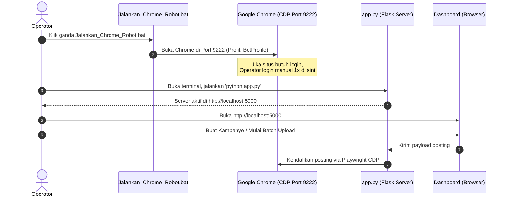

# 📖 Panduan Operasional & Pemecahan Masalah (Operational SOP & Troubleshooting Guide)

Dokumen ini adalah panduan praktis sehari-hari bagi operator untuk menjalankan, merawat, dan mengatasi masalah (*troubleshooting*) pada sistem **AutoPost Matrix (DSE Automation)**.

---

## 1. Prosedur Operasional Standar (SOP Harian)

Untuk memastikan otomatisasi berjalan mulus dengan tingkat keberhasilan tertinggi, ikuti urutan langkah berikut:



### Langkah Rinci:
1. **Pastikan File Excel Tertutup:**
   Tutup program Microsoft Excel jika file `tracker-posting.xlsx` sedang terbuka di layar Anda. Menutup Excel mencegah terjadinya bentrok akses file (*file permission lock*).
2. **Jalankan Chrome Robot Terlebih Dahulu:**
   Klik ganda pada file:
   ```text
   Jalankan_Chrome_Robot.bat
   ```
   Tunggu hingga jendela Google Chrome muncul. Jendela ini menggunakan profil khusus robot di folder `BotProfile` yang terpisah dari browser harian Anda.
3. **Pemeriksaan Sesi Akun (Jika Diperlukan):**
   Jika Anda berniat memposting ke platform yang membutuhkan login (misalnya WordPress, Blogger, Imgur, Medium), buka website tersebut di jendela Chrome Robot ini dan pastikan Anda sudah masuk ke akun Anda. Anda **tidak perlu login lagi** di hari-hari berikutnya karena cookie sesi tersimpan otomatis.
4. **Jalankan Server Dashboard:**
   Buka terminal PowerShell di folder proyek, lalu jalankan:
   ```bash
   python app.py
   ```
5. **Mulai Eksekusi Melalui Web Dashboard:**
   Buka browser utama Anda ke alamat **`http://localhost:5000`**. Masuk ke tab **Campaign Uploader**, isi data kampanye Anda, dan klik tombol **Start Batch Upload**.

---

## 2. Panduan Pemecahan Masalah (Troubleshooting)

### ❓ Kasus 1: Error "Target page, context or browser has been closed" atau Gagal Menyambung ke CDP
- **Penyebab:**
  Server mencoba menyambung ke port `9222`, tetapi jendela Chrome Robot belum dibuka atau Chrome Robot tertutup secara tidak sengaja.
- **Solusi:**
  1. Periksa apakah ada jendela Chrome dengan header debugging yang sedang terbuka.
  2. Jika belum ada, klik ganda `Jalankan_Chrome_Robot.bat`.
  3. Pastikan tidak ada proses Chrome nyasar yang memblokir port 9222. Jika ragu, buka Task Manager dan akhiri (*End Task*) proses `chrome.exe`, lalu jalankan kembali bat file tersebut.

---

### ❓ Kasus 2: Error `PermissionError: [Errno 13] Permission denied: 'tracker-posting.xlsx'`
- **Penyebab:**
  File `tracker-posting.xlsx` sedang dibuka di aplikasi Microsoft Excel desktop pada saat robot mencoba menulis hasil postingan. Windows memberlakukan penguncian eksklusif (*exclusive file lock*) pada file yang sedang dibuka di Excel.
- **Solusi:**
  1. Simpan dan tutup jendela Microsoft Excel Anda.
  2. Sistem secara otomatis memiliki mekanisme retry 3 kali. Setelah Excel ditutup, penyimpanan akan berhasil.

---

### ❓ Kasus 3: Error `429 Too Many Requests` saat Menjalankan Phase A (AI Learner)
- **Penyebab:**
  Batas kuota harian atau kuota per menit (15 RPM) pada Google Gemini Free Tier terlampaui karena terlalu banyak situs dipindai dalam tempo singkat.
- **Solusi:**
  1. Hentikan sejenak proses Phase A selama 1–2 menit.
  2. Jalankan pemindaian situs baru secara bertahap (misal 5 atau 10 situs per sesi, bukan langsung 100 situs).
  3. Pastikan kunci API di `.env` masih aktif dan memiliki kuota yang cukup di Google AI Studio.

---

### ❓ Kasus 4: Laptop Terasa Berat atau Folder `BotProfile` Membengkak (>1 GB)
- **Penyebab:**
  Chrome mengumpulkan cache web (gambar, skrip, data sementara) di folder `BotProfile\Default\Cache` saat mengunjungi puluhan website.
- **Solusi:**
  Jalankan pembersihan cache tanpa menghapus cookie login. Anda dapat menjalankan perintah Python berikut di terminal:
  ```bash
  python -c "import os, shutil; [shutil.rmtree(os.path.join('BotProfile', 'Default', p), ignore_errors=True) for p in ['Cache', 'Code Cache', 'GPUCache']]; print('Cache berhasil dibersihkan!')"
  ```
  *(Perintah ini hanya membuang cache media volatile, seluruh cookie login dan password tetap aman tersimpan).*

---

### ❓ Kasus 5: Situs Tertentu Ditandai "Failed / Skipped"
- **Penyebab & Solusi:**
  - **Jika Situs Membutuhkan Login:** Buka situs tersebut di jendela Chrome Robot, lakukan login secara manual, lalu ulangi upload untuk situs tersebut.
  - **Jika Situs Memasang Cloudflare Turnstile Interaktif:** Pastikan opsi browser di dashboard diatur ke **"Visible Headed Browser Window"** agar Anda dapat melihat tampilan browser dan mencentang kotak verifikasi jika diperlukan.
  - **Jika Situs Sudah Mati / Domain Dijual:** Tambahkan domain situs tersebut ke dalam file `blacklist.txt` agar robot melewatinya secara otomatis di masa depan.

---

## 3. Tips Praktis & Praktik Terbaik (Best Practices)

1. **Gunakan Mode Visible Browser Saat Menguji Kampanye Baru:**
   Saat menjalankan kampanye pertama kali, pilih mode *Visible Browser* di antarmuka dashboard. Dengan cara ini, Anda dapat melihat secara langsung bagaimana robot berinteraksi dengan website target dan segera mengetahui jika ada pop-up tak terduga (seperti banner cookie GDPR).
2. **Variasi Konten (Spam Prevention):**
   Hindari memposting judul dan teks yang 100% identik ke puluhan website dalam hitungan menit. Sedikit variasikan judul kampanye untuk mencegah filter spam otomatis pada penyedia hosting.
3. **Cara Menambah Target Website Baru:**
   - Buka file `tracker-posting.xlsx`.
   - Tambahkan baris baru dengan mengisi kolom `No`, `Situs / Web`, dan `Kategori`.
   - Simpan dan tutup file Excel.
   - Refresh antarmuka dashboard; situs baru akan langsung muncul di tabel matrix.
4. **Cara Mem-blacklist Situs yang Tidak Diinginkan:**
   - Buka file `blacklist.txt`.
   - Tambahkan domain situs di baris paling bawah (contoh: `situsjelek.com`).
   - Simpan file. Robot akan langsung mengabaikan situs tersebut pada eksekusi berikutnya.
